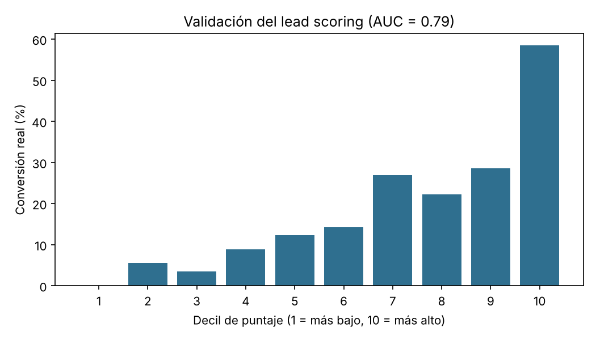

# Lead scoring y calificación MQL / SQL en Python

Modelo que asigna a cada lead un puntaje de 0 a 100 según su probabilidad de convertir y lo clasifica en una etapa del embudo:

| Etapa | Regla | Acción sugerida |
|---|---|---|
| **SQL** | puntaje ≥ 70 **y** (llenó formulario **o** tiene cargo decisor) | Asignar a ventas |
| **MQL** | puntaje ≥ 40 | Secuencia de correos y seguimiento de mercadeo |
| **Nutrición** | puntaje < 40 | Contenido de nutrición, sin contacto comercial |

Los umbrales son parámetros de negocio (`UMBRAL_SQL`, `UMBRAL_MQL` en `lead_scoring.py`) y se ajustan según la capacidad del equipo de ventas.

> Los datos son **sintéticos**. El proyecto muestra el método completo, no describe clientes reales.

## Resultados

En el conjunto de prueba (900 leads) el modelo obtiene un **AUC de 0,79**:

| Etapa | Leads | Conversión real |
|---|---|---|
| SQL | 23 | 78,3 % |
| MQL | 81 | 50,6 % |
| Nutrición | 796 | 12,9 % |

Un lead SQL convierte seis veces más que uno en nutrición, así que ventas puede concentrarse en una lista corta.



Las señales con más peso son llenar un formulario, tener un cargo decisor y descargar contenido; los días sin interacción y la llegada por pauta bajan el puntaje.

## Cómo usarlo

```bash
pip install -r requirements.txt
python lead_scoring.py                     # entrena, valida y guarda el modelo
python calificar_nuevos.py nuevos_leads.csv  # califica leads nuevos
```

`calificar_nuevos.py` está pensado como paso de un flujo automatizado: recibe la exportación de un formulario de WordPress o de un CRM y devuelve el mismo archivo con `puntaje` y `etapa`, listo para reimportar o para disparar una acción (asignar a un vendedor, iniciar una secuencia de correos).

## Estructura

```
lead_scoring.py        generación de datos, entrenamiento, validación y reglas MQL/SQL
calificar_nuevos.py    calificación automática de leads nuevos
nuevos_leads.csv       ejemplo de entrada
resultados/            modelo entrenado, base calificada y gráfica
```

Autor: Johan Gefrey Brausin Varon
